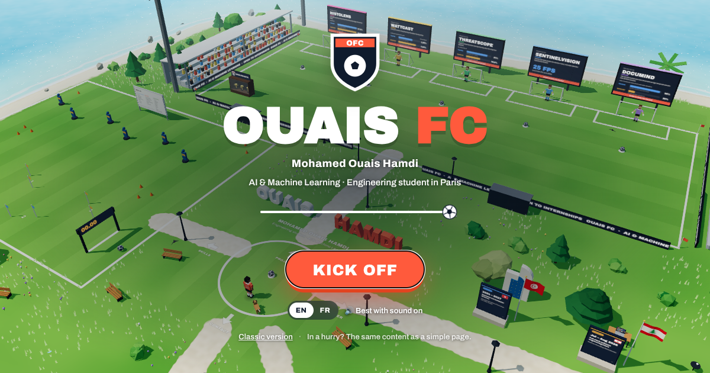

# Ouais FC ⚽ — my portfolio, as a football game

**▶ Play it: [medouaishamdi.github.io](https://medouaishamdi.github.io)** · Classic version: [medouaishamdi.github.io/classic](https://medouaishamdi.github.io/classic/)

I'm Mohamed Ouais Hamdi, a first-year engineering student at ESIEE-IT (Paris) with a software-engineering background from IIT Sfax, and I'm passionate about AI and machine learning. Instead of a page of links, my portfolio is a small 3D football game: you walk around an island, and **every goal in the stadium is one of my projects**. Score, and the project opens.

## How to play

| | Keyboard | Phone |
|---|---|---|
| Move · Sprint | Arrow keys or WASD · hold Shift | Joystick |
| Shoot / pass | Space (hold for power) | Kick button |
| Interact (signs, desks, screens) | Enter | Tap the button that appears |
| Map · Menu | M · Esc | Icons at the top |
| 60-second tour · Photo mode · Replay | T · P · Y | Menu |

In a hurry? Click **"Recruiter? Take the 60-second tour"** on the welcome screen, and the camera visits everything for you. Recruiters can also **enter as their company**: type its name and the player wears your company's shirt.

## What's on the island

- **The stadium**: 5 goals, one per project, each with a scoreboard showing two numbers: the score in training conditions and the score on "match day", on data the model had never seen.
- **The Match Analysis room**: real demos running inside your browser, with nothing to install:
  - **HistoLens**: my tissue classifier (an 8-bit ONNX model) classifies real histology images.
  - **WattCast**: replay any day of my electricity forecast against the real consumption.
  - **ThreatScope**: watch the intrusion detector judge network traffic as a live feed.
- **The press room**: ask me anything about my projects. Answers are built only from my CV and project write-ups, with their sources.
- **The career road**, **skills pitch**, **penalty shootout** against Byte the keeper, **photo mode**, **instant replays**, and 38 achievements to unlock.

Everything is in **English and French**.

## The projects and their live demos

| Project | What it does | Live demo | Code |
|---|---|---|---|
| **HistoLens** | Colorectal tissue classification (9 types), tested on another hospital: 95.7% accuracy | [Open](https://histolens-medouaishamdi.streamlit.app) | [GitHub](https://github.com/medouaishamdi/histolens) |
| **WattCast** | Day-ahead forecast of France's electricity demand: 2.18% error over 7.5 years | [Open](https://wattcast-medouaishamdi.streamlit.app) | [GitHub](https://github.com/medouaishamdi/wattcast) |
| **ThreatScope** | Intrusion detection tested on 17 attack types it never saw | [Open](https://threatscope-medouaishamdi.streamlit.app) | [GitHub](https://github.com/medouaishamdi/threatscope) |
| **SentinelVision** | Real-time detection and tracking of people and vehicles on a CPU | [Open](https://sentinelvision-medouaishamdi.streamlit.app) | [GitHub](https://github.com/medouaishamdi/sentinelvision) |
| **DocuMind** | Ask questions about your documents and get cited answers (RAG) | [Open](https://documind-e22o.onrender.com) | [GitHub](https://github.com/medouaishamdi/documind) |

The demos run on free hosting: if one hasn't been used for a while, it may take **30–60 seconds to wake up** the first time.

## How it's built

- **TypeScript** and **Three.js** for the 3D world, **cannon-es** for the physics, and the **Web Audio API** for all the sounds.
- No game engine and no 3D model or audio files: the players, the stadium, the trees and the sounds are all generated in code.
- **ONNX Runtime Web** runs the HistoLens model directly in the visitor's browser.
- Bundled with **Vite**. The classic version is a static site built with **Astro**.

This repository contains the **built website** that GitHub Pages serves.

## Contact

- Email: [ouaishamdi8@gmail.com](mailto:ouaishamdi8@gmail.com)
- LinkedIn: [linkedin.com/in/medouaishamdi](https://www.linkedin.com/in/medouaishamdi)
- GitHub: [github.com/medouaishamdi](https://github.com/medouaishamdi)

I'm looking for my end-of-studies internship (PFE) in AI, data or software engineering.
